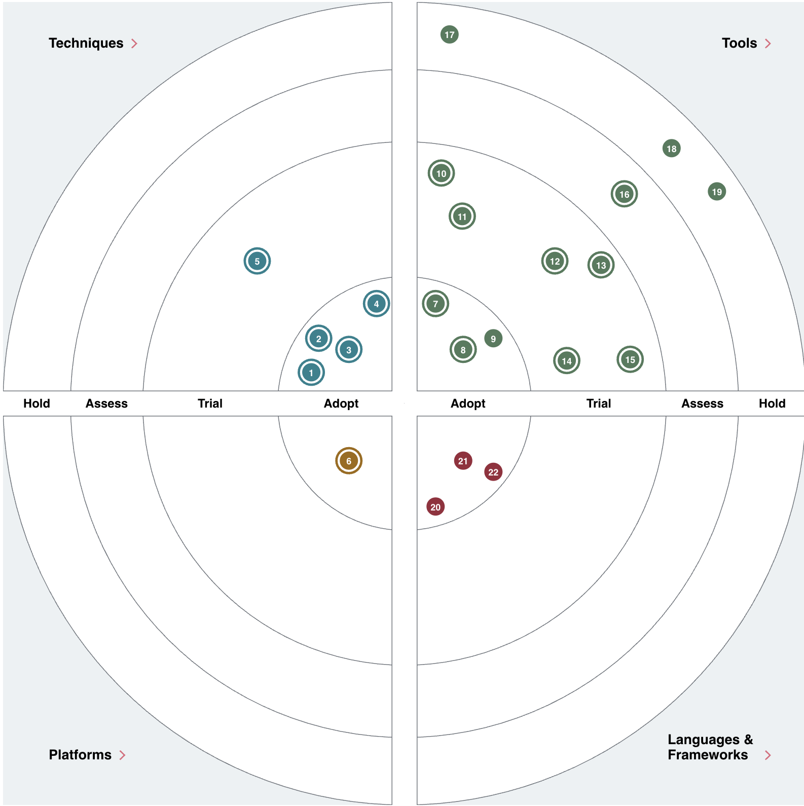
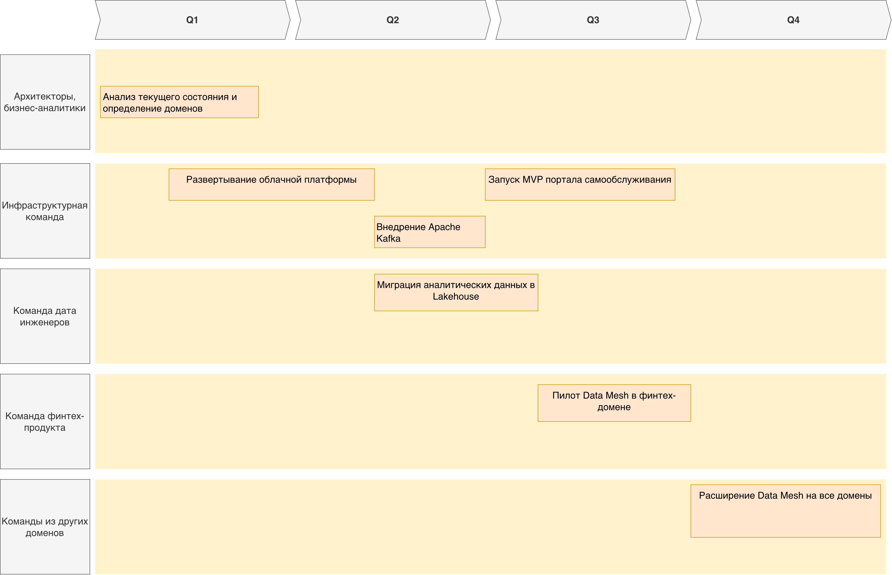

# Техно радар

| №  | Наименование                 | ring   | quadrant                 | description                                                                                    |
| -- | ---------------------------- | ------ | ------------------------ | ---------------------------------------------------------------------------------------------- |
| 1  | Data Mesh                    | Adopt  | Techniques               | Интеграция новых бизнес-направлений без переделки DWH                                          |
| 2  | Domain-Driven Design (DDD)   | Adopt  | Techniques               | Определение границ между медицинскими, финансовыми и ИИ-доменами                               |
| 3  | Event-Driven Architecture    | Adopt  | Techniques               | Асинхронная интеграция доменов через события                                                   |
| 4  | Infrastructure as Code (IaC) | Adopt  | Techniques               | Быстрое развертывание сред для новых доменов Управление конфигурациями в разных средах      |
| 5  | Data Product                 | Trial  | Techniques               | Предоставление данных между доменами как сервиса Монетизация данных для внешних партнеров   |
| 6  | Cloud Platform               | Adopt  | Platforms                | Масштабирование аналитических нагрузок Геораспределенное развертывание сервисов             |
| 7  | Apache Kafka                 | Adopt  | Tools                    | Замена устаревшей шины Apache Camel. Асинхронный обмен данными между доменами               |
| 8  | Terraform                    | Adopt  | Tools                    | Infrastructure as Code для облачных ресурсов Автоматизация развертывания инфраструктуры     |
| 9  | Power BI                     | Adopt  | Tools                    | Платформа для портала самообслуживания                                                         |
| 10 | Apache Airflow               | Trial  | Tools                    | Управление конвейерами данных между доменами Автоматизация сложных трансформаций            |
| 11 | Apache Spark                 | Trial  | Tools                    | Управление конвейерами данных между доменами Автоматизация сложных трансформаций            |
| 12 | Dremio                       | Trial  | Tools                    | Data Lake Engine для ускорения запросов к данным в озере                                       |
| 13 | Nessie                       | Trial  | Tools                    | Git-like версионирование для Data Lake Ветвление и слияние наборов данных для экспериментов |
| 14 | DataHub                      | Trial  | Tools                    | Каталогизация Data Products между доменами                                                     |
| 15 | Apache Iceberg               | Trial  | Tools                    | Открытый табличный формат для Data Lake                                                        |
| 16 | Ceph                         | Assess | Tools                    | Распределенное object storage для больших объемов данных                                       |
| 17 | PowerBuilder                 | Hold   | Tools                    | Устаревшая клиентская технология                                                               |
| 18 | Apache Camel                 | Hold   | Tools                    | Устаревшая интеграционная шина                                                                 |
| 19 | MSSQL 2008                   | Hold   | Tools                    | Устаревшая версия SQL Server, требующая обновления                                             |
| 20 | Python                    | Adopt  | languages-and-frameworks | Разработка ИИ-сервисов для медицинских данных                                                  |
| 21 | Golang                       | Adopt  | languages-and-frameworks | Сервисы финтех-домена                                                                          |
| 22 | Java                         | Adopt  | languages-and-frameworks | Сервисы финтех-домена                                                                          |

# Roadmap

## Этапы:

| № Этапа | Наименование                                    | Ожидаемые результаты                                           | Ответственные команды                | Ресурсы                                             | Бизнес-обоснование                                                                                                                      |
| ------- | ----------------------------------------------- | -------------------------------------------------------------- | ------------------------------------ | --------------------------------------------------- | --------------------------------------------------------------------------------------------------------------------------------------- |
| 1       | Анализ текущего состояния и определение доменов | Карта доменов с четкими границами                              | Архитекторы, бизнес-аналитики        | инструменты документирования                        | Четкие домены ускоряют принятие решений о развитии Готовность к подключению новых бизнесов Есть ответственные за данные и сервисы |
| 2       | Развертывание облачной платформы                | Готовая облачная инфраструктура                                | Инфраструктурная команда             | Terraform, Cloud-Платформа (например, яндекс cloud) | Снижение затрат Гибкое выделение ресурсов под нагрузку Повышение доступности сервисов                                             |
| 3       | Миграция аналитических данных в Lakehouse       | Data Lakehouse с аналитическими данными                        | команда data-инженеров               | Spark, Airflow                                      | Отчеты формируются за минуты вместо часов Актуальные данные для принятия решений Масштабируемость                                 |
| 4       | Запуск MVP портала самообслуживания             | Работающий портал самообслуживания                             | Инфраструктурная команда             | Dremio                                              | Прямой доступ к данным без посредников Актуальные данные                                                                             |
| 5       | Внедрение Apache Kafka                          | Работающая событийная шина                                     | Инфраструктурная команда             | Kafka                                               | Упрощение интеграций Масштабирование - Легкое подключение новых систем Надежность                                                 |
| 6       | Пилот Data Mesh в финтех-домене                 | Первый работающий Data Product                                 | Финтех-команда + Data Mesh Core Team | DataHub, Apache Kafka, мониторинг                   | Самостоятельный доступ к финансовым данным Пример для других доменов                                                                 |
| 7       | Расширение Data Mesh на все домены              | Полная Data Mesh архитектура, Самостоятельное развитие доменов | Domain Teams + Data Mesh Core Team   | DataHub, Apache Kafka, мониторинг                   | Независимое развитие подразделений Децентрализованное управление данными Эффективное использование ресурсов                       |

